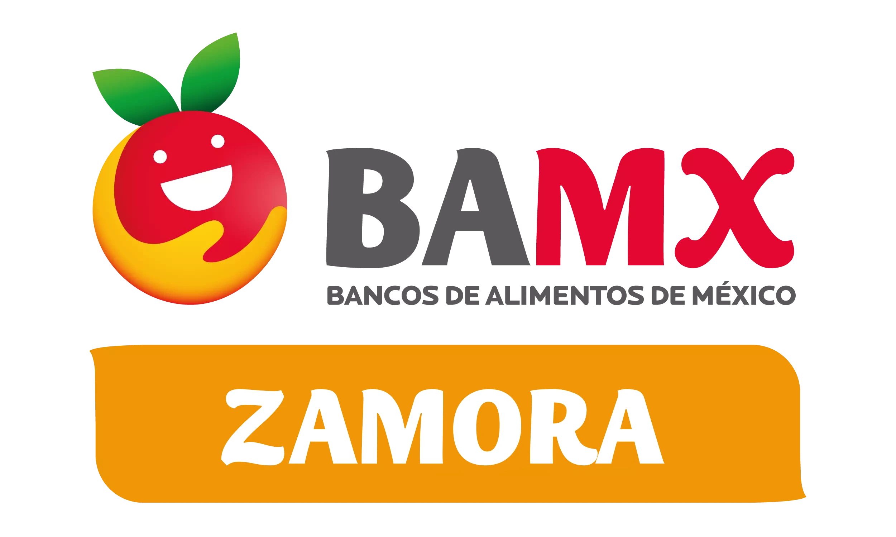

<h1 align="center">Banco de Alimentos de Zamora – Página Web</h1>

Plan y avance de la migración: [PLAN-MIGRACION-STRAPI.md](docs/PLAN-MIGRACION-STRAPI.md).
Arranque del backend actual y configuración de contacto: [cms/README.md](cms/README.md).

  

  Sitio web oficial del <strong>Banco de Alimentos de Zamora (BAMX Zamora)</strong>, desarrollado con <strong>Vite + React</strong> para comunicar programas, actividades e impacto social, y fortalecer la conexión con beneficiarios, voluntarios y aliados.

<h2>Estructura del Proyecto</h2>

La organización de carpetas es la siguiente:

El repositorio contiene dos aplicaciones: el sitio público (Vite + React) y el CMS (Strapi).

<pre><code>├── public/
│   └── fonts/              # Fuentes utilizadas en el proyecto
├── src/                    # Sitio público
│   ├── assets/             # Imágenes y recursos estáticos
│   ├── components/         # Componentes reutilizables de React
│   ├── content/            # Contenido inicial: solo para la carga inicial de Strapi
│   ├── pages/              # Páginas principales de la aplicación
│   ├── utils/cms.js        # URL pública del CMS
│   ├── App.jsx             # Punto central de renderizado y rutas
│   ├── index.css           # Estilos globales (usa las fuentes de /public)
│   └── main.jsx            # Punto de entrada del proyecto
├── cms/                    # CMS (Strapi): esquemas, contacto y panel en español
├── shared/content/         # Contrato de datos compartido entre Strapi y React
├── docs/                   # Plan e inventario de la migración
├── tests/                  # Pruebas del contrato de contenido
├── .gitignore              # Archivos y carpetas ignorados por Git
├── index.html              # Página principal del proyecto
├── package.json            # Dependencias y scripts del proyecto
├── README.md               # Documentación (este archivo)
└── vite.config.js          # Configuración de Vite (alias, plugins)
</code></pre>

<h2>Cómo arrancar</h2>

Son dos procesos. <strong>Todo el contenido del sitio sale de Strapi</strong>: sin el CMS
corriendo, el sitio muestra "No pudimos cargar la página".

<pre><code># CMS (http://localhost:1337, panel en /gestion-bamx)
cd cms
npm install
npm run develop
npm run seed          # solo en una base nueva: importa el contenido inicial

# Sitio público (http://localhost:5173)
npm install
npm run dev
</code></pre>

Copia <code>.env.example</code> a <code>.env</code> en la raíz y en <code>cms/</code>.
El detalle de las variables de contacto y del panel está en
<a href="cms/README.md">cms/README.md</a>. La guía para quien edita el sitio está en
<a href="docs/GUIA-CLIENTE.md">docs/GUIA-CLIENTE.md</a>.

<h3>Pruebas</h3>

<pre><code>npm test                     # contratos de contenido (raíz)
npm run lint && npm run build
npm run smoke                # renderiza cada página con el contenido real (Strapi arriba)
cd cms && npm test           # CMS
cd cms && npm run test:integration   # Strapi real contra la base configurada
</code></pre>

<strong>Despliegue:</strong> <code>.github/workflows/deploy.yml</code> publica el sitio en
cada push a <code>master</code>. Desde la migración el sitio necesita Strapi desplegado y
accesible (mismo dominio con Nginx en <code>/api</code> y <code>/uploads</code>, o
<code>VITE_CMS_URL</code>). No mergear a <code>master</code> antes de desplegar Strapi.

<h2>Tecnologías Utilizadas</h2>

<table>
  <tr>
    <th>Tecnología</th>
    <th>Descripción</th>
  </tr>
  <tr>
    <td><strong>Vite</strong></td>
    <td>Herramienta moderna de desarrollo web con recarga rápida y configuración ligera.</td>
  </tr>
  <tr>
    <td><strong>React</strong></td>
    <td>Biblioteca de JavaScript para construir interfaces de usuario interactivas y modulares.</td>
  </tr>
  <tr>
    <td><strong>Tailwind CSS</strong></td>
    <td>Framework de utilidades CSS que permite un diseño responsivo y consistente.</td>
  </tr>
  <tr>
    <td><strong>Strapi</strong></td>
    <td>CMS que permite al equipo del banco editar y publicar el contenido del sitio sin tocar código.</td>
  </tr>
</table>

<h2>Objetivo del Proyecto</h2>

<ul>
  <li>Difundir las <strong>acciones e impacto social</strong> del Banco de Alimentos.</li>
  <li>Facilitar la <strong>comunicación con beneficiarios y colaboradores</strong>.</li>
  <li>Promover la <strong>transparencia y confianza</strong> en los programas del BAMX Zamora.</li>
</ul>
